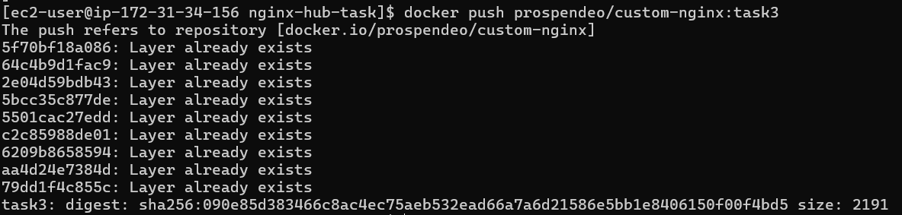
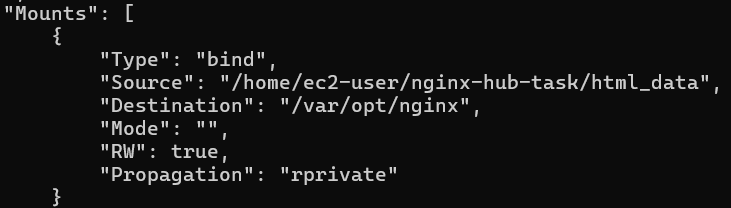

# Docker Task 3: Nginx Deployment with Bind Mounts

## Overview
This project demonstrates containerization skills, specifically deploying a custom Nginx web server on an **AWS EC2** instance. The core objective was to configure a secure, persistent **bind mount** and host the resulting custom image on **Docker Hub**.

## Tech Stack
* **Cloud Infrastructure:** AWS EC2 (Amazon Linux 2023)
* **Containerization:** Docker & Docker Compose
* **Registry:** Docker Hub

## Key Deliverables
* **Custom Bind Mount:** Configured a volume mapping local directory `./html_data` to the container path `/var/opt/nginx`.
* **Image Registry:** Built and pushed a custom Nginx image (`prospendeo/custom-nginx:task3`) to Docker Hub.

## Evidence of Completion

### 1. Docker Hub Repository
Verification of the successfully pushed custom image.

### 2. Container Inspect (Bind Mount Verification)
Confirmation that the bind mount is correctly mapped to the required destination.

### 3. CLI Push Success
Terminal confirmation of successful authentication and layer transfer to the registry.

---
*Project completed as part of Docker Swarm.*
